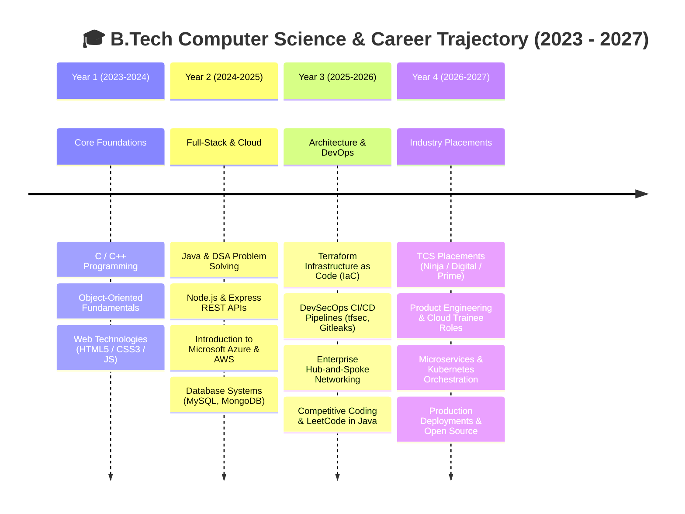
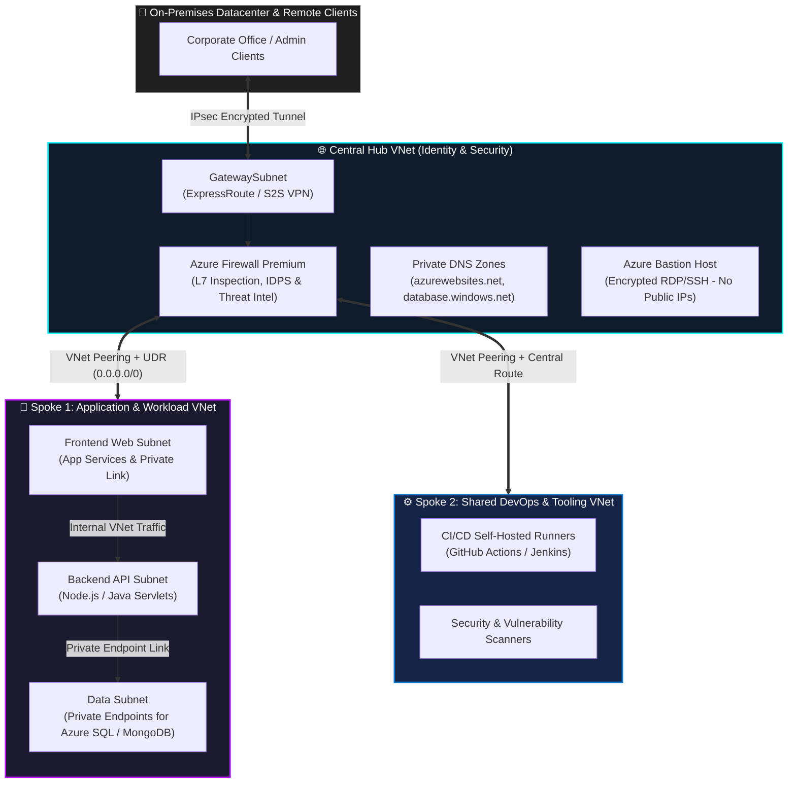
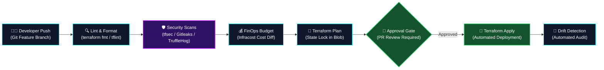

<!-- ╔══════════════════════════════════════════════════════════════════════╗ -->
<!--        ANURAG KUMAR // CLOUD, DEVSECOPS & SOFTWARE ENGINEER           -->
<!-- ╚══════════════════════════════════════════════════════════════════════╝ -->

<div align="center">
  
</div>

<div align="center">

# ⚡ ANURAG KUMAR
### Software Development • Cloud Engineering • Infrastructure Automation • DevSecOps
**B.Tech in Computer Science and Engineering (Batch of 2027) • Galgotias University**

<p align="center">
  
</p>

<br>

<a href="https://github.com/the-anurag14">
  
</a>


</div>

---

# 🎯 Executive Summary & The Hybrid Advantage

<div align="left">
  
</div>

I am an engineering undergraduate who actively merges **Core Computer Science & Software Engineering (Java, OOP, Data Structures, Full-Stack Development)** with **Enterprise Cloud Architecture, Infrastructure as Code (Terraform), and DevSecOps Shift-Left Security**.

* 🚀 **Class of 2027 Talent:** Highly motivated with strong academic rigor (**8.25 CGPA**) and active hands-on building experience.
* 💻 **Full-Stack & Backend Systems:** Developing scalable RESTful APIs, authentication workflows (JWT), and modular backends across Node.js/Express and enterprise Java Servlets.
* ☁️ **Cloud Infrastructure as Code:** Architecting Azure & AWS landing zones, automated with Terraform, remote state management, and CI/CD pipelines.
* 🔐 **DevSecOps Shift-Left:** Enforcing automated security linting (`tflint`), vulnerability scanning (`tfsec`), and secret detection (`Gitleaks`, `TruffleHog`) directly in the build pipeline.
* 🎯 **Placement Ready:** Actively preparing for 2027 software engineering campus & off-campus drives including **TCS (Ninja, Digital, Prime)**, product engineering roles, and cloud/DevOps positions.

<br clear="right"/>

---

# 🎓 Academic Performance & 2023–2027 Milestone Tracker

### 📌 Academic Record

| Degree / Certification | Institution / Board | Duration | Score / CGPA |
| :--- | :--- | :---: | :---: |
| **Bachelor of Technology (B.Tech) — CSE** | **Galgotias University** | **2023 – 2027** | **8.25 / 10.0 CGPA** |
| **Senior Secondary Examination (Class XII)** | CBSE / State Board | 2022 | **69.4%** |
| **Secondary School Examination (Class X)** | CBSE / State Board | 2020 | **85.6%** |

<br>

### 🗺️ B.Tech CSE Graduation & Career Roadmap



---

# 🚀 Technical Competencies

<p align="center">
  
</p>

| Category | Technologies & Tools |
| :--- | :--- |
| **☕ Programming Languages** | Java, Python, C, C++, JavaScript (ES6+), TypeScript |
| **🌐 Frontend Development** | HTML5, CSS3, React, Vite, Tailwind CSS |
| **⚡ Backend Development** | Node.js, Express.js, Java Servlets, RESTful APIs, JWT Authentication |
| **☁️ Cloud & Infrastructure** | Microsoft Azure, AWS, Terraform (IaC), Linux / Bash, Docker |
| **⚙️ CI/CD & Automation** | GitHub Actions, Jenkins, Azure DevOps, Git, GitHub |
| **🔐 DevSecOps & Security** | TFLint, tfsec, Gitleaks, TruffleHog, Terraform Validation, Secret Scanning |
| **🗄️ Database Systems** | MySQL, MongoDB (Atlas), Firebase, Oracle SQL |
| **📱 Mobile Development** | Android Development, Kotlin, Jetpack Compose |

---

# 🏗️ Enterprise Cloud & System Architecture Blueprints

### 🌐 1. Enterprise Hub-and-Spoke Cloud Network Architecture
*A centralized, highly secure networking topology designed to enforce micro-segmentation, centralized egress inspection, and zero public exposure for private workloads.*



---

### 🛡️ 2. DevSecOps Shift-Left CI/CD Pipeline
*Security, cost estimation, and compliance guardrails integrated directly into every stage of the infrastructure deployment process.*



---

### 🏛️ 3. The 10 Enterprise Scalability & Quality Pillars

| Pillar | Engineering Practice & Enterprise Implementation |
| :---: | :--- |
| **1. Scalable** | Horizontal auto-scaling with Virtual Machine Scale Sets (VMSS) & stateless backend APIs. |
| **2. Robust** | Graceful degradation, circuit-breaker patterns, and automated health checks. |
| **3. Secure** | Zero Trust architecture, Entra ID Privileged Identity Management (PIM), and secret scanning. |
| **4. Reliable** | Resilient multi-region paired failovers targeting high-availability SLAs (99.99%). |
| **5. Portable** | Containerized workloads via Docker and modular multi-cloud Terraform Infrastructure as Code. |
| **6. Governed** | Azure Policy initiatives (CIS Benchmarks, MCSB) enforced at Management Group scope. |
| **7. High Availability** | Zone-Redundant Storage (ZRS) & deployments distributed across multiple Availability Zones. |
| **8. Cost-Optimized (FinOps)** | Automated orphan resource cleanup, VM rightsizing, and non-prod off-hours scheduling. |
| **9. Backed Up (DR)** | Explicit **RTO** (Downtime tolerance) & **RPO** (Data loss tolerance) with Azure Site Recovery. |
| **10. Monitored** | Unified telemetry via Azure Monitor Agent (AMA), centralized Log Analytics, and proactive alerts. |

---

# 💻 System Monitor & Developer Terminal

```text
┌────────────────────────────────────────────────────────────────────────────────────────┐
│ USER         : ANURAG KUMAR                                                            │
│ GITHUB       : @the-anurag14                                                           │
│ ACADEMICS    : B.TECH COMPUTER SCIENCE & ENGINEERING • GALGOTIAS UNIVERSITY (2023-2027)│
│ CGPA         : 8.25 / 10.0                                                             │
│ INTERESTS    : SOFTWARE DEV • CLOUD (AZURE/AWS) • DEVOPS • INFRASTRUCTURE AUTOMATION   │
│ STATUS       : ● ACTIVE LEARNING & BUILDING [ONLINE ⚡]                                │
└────────────────────────────────────────────────────────────────────────────────────────┘
```

```bash
$ whoami
anurag@cloud-engineer:~$ software-engineer-in-training --target 2027

$ cat engineering_philosophy.txt
"Learn the core fundamentals. Build production-grade systems. Automate infrastructure. Shift security left."

$ cat current_focus.json
{
  "dsa": "Java Collections & Algorithmic Problem Solving",
  "cloud": "Azure Landing Zones & Terraform Automation",
  "devsecops": "Automated Linting, Secrets Scanning & Infracost",
  "placements": "2027 Campus & Off-Campus Software Engineering Drives"
}
```

---

# 🏠 Featured Projects

### 💼 [Job Portal Application](https://github.com/the-anurag14/job-portal)
> **Full-Stack Recruitment Platform with Multi-Tier Architecture**

A practical software platform designed to manage the end-to-end recruitment lifecycle, candidate applications, and job postings.
* **Architecture:** Decoupled 3-tier architecture with secure RESTful APIs, JWT role-based authentication (Job Seekers vs Employers), and relational/NoSQL data models.
* **Dual Implementation:** Engineered using **Node.js, Express.js, and MongoDB Atlas**, alongside a separate enterprise **Java Servlets & MySQL** implementation running on Apache Tomcat.
* **Tech Stack:** `Node.js` `Express.js` `MongoDB Atlas` `JWT` `Java Servlets` `MySQL` `Apache Tomcat`
* 👉 [Explore Repository →](https://github.com/the-anurag14/job-portal)

---

### ☁️ [Azure Infrastructure Automation](https://github.com/the-anurag14/b18-infra)
> **Infrastructure as Code (IaC) with Terraform & GitHub Actions**

Hands-on cloud infrastructure automation repository provisioning enterprise-ready foundational networking and compute on Microsoft Azure.
* **Key Implementation:** Automated creation of Azure Resource Groups, Virtual Networks (VNets), Subnets, and Network Security Groups (NSGs).
* **IaC Practices:** Parameterized Terraform modules with Azure Blob Storage remote state locking and automated validation workflows.
* **Tech Stack:** `Microsoft Azure` `Terraform` `GitHub Actions` `Linux / Bash`
* 👉 [Explore Repository →](https://github.com/the-anurag14/b18-infra)

---

### 📚 [Data Structures & Algorithms in Java](https://github.com/the-anurag14/DS_Java_Galgotias)
> **Algorithmic Problem Solving & Computational Thinking**

Structured problem-solving repository documenting my implementation of core Data Structures & Algorithms in Java.
* **Focus Areas:** Arrays, Linked Lists, Stacks, Queues, Binary Trees, Recursion, Searching & Sorting, and Complexity Optimization ($O(N)$, $O(\log N)$).
* **Tech Stack:** `Java` `Data Structures` `Algorithms` `Problem Solving`
* 👉 [Explore Repository →](https://github.com/the-anurag14/DS_Java_Galgotias)

---

### ⚡ [Tech-Bits](https://github.com/the-anurag14/Tech-Bits)
> **Engineering Prototypes & Technical Exploration**

A sandbox repository for experimenting with modern development concepts, architecture patterns, and hands-on technical ideas.
* **Tech Stack:** `Software Engineering` `Prototyping` `Exploration`
* 👉 [Explore Repository →](https://github.com/the-anurag14/Tech-Bits)

---

### 🎓 [Academic Development Journey](https://github.com/the-anurag14/Gu_Anurag_Kumar_23SCSE1010414)
> **B.Tech CSE Academic Journey (2023 - 2027) • Galgotias University**

Tracking academic development, computer science lab implementations, and engineering milestone projects (`23SCSE1010414`).
* **Tech Stack:** `Computer Science Fundamentals` `Academic Projects`
* 👉 [Explore Repository →](https://github.com/the-anurag14/Gu_Anurag_Kumar_23SCSE1010414)

---

### 🛠️ Additional Engineering Projects

* **🛡️ DevSecOps CI/CD Pipeline:** Automated multi-stage deployment pipeline using GitHub Actions & Jenkins, enforcing code formatting (`terraform fmt`), linting (`TFLint`), security scanning (`tfsec`), and secret detection (`Gitleaks`, `TruffleHog`).
* **🗄️ CloudVault:** Web application for secure file management, featuring REST APIs, MongoDB connectivity, and modern responsive frontend integration using Node.js, Vite, and TypeScript.
* **🎬 StreamFlix Cloud Deployment:** Cloud architecture project transferring application builds to Azure Virtual Machines, configuring VNets, security rules, and persistent storage.
* **🏫 Smart India Hackathon — Remote Classroom:** Educational technology platform utilizing Python and Firebase to power collaborative remote learning workflows.
* **🏥 Online Healthcare Management System:** Academic software system handling patient appointments, medical records, and doctor scheduling.
* **🎟️ Online Movie Ticket Booking System:** Software engineering project featuring theater catalog browsing, real-time seat selection, and booking management.

---

# 💼 Internships & Experience

| Role / Program | Organization | Focus & Key Contributions |
| :--- | :--- | :--- |
| **HCL Jigsaw Mentor** | **HCL GUVI** (2026) | Mentored students in technical problem-solving, programming foundations, and hackathon project execution. |
| **AWS Cloud Internship** | **AWS Virtual Program** | Hands-on exploration of AWS cloud services, compute (EC2), storage (S3), IAM policies, and cloud networking. |
| **Google Android Developer Virtual Internship** | **Google / Eduskills** | Mobile application development using Kotlin, Android Studio, UI components, and modern Android architecture. |
| **Google AI/ML Virtual Internship** | **Google / Eduskills** | Foundational AI/ML workflows, data preprocessing, model evaluation, and introductory machine learning concepts. |
| **AICTE Android Internship** | **AICTE** | Android application development, component lifecycles, UI layouts, and mobile performance optimization. |
| **Wipro TalentNext Program** | **Wipro** | Intensive training in Java Full Stack development, Object-Oriented Programming, and database integration. |
| **System UX Engineer** | **XarrowAI Industries** | Collaborated on interface workflows, user experience alignment, and front-facing technical coordination. |

---

# 📜 Certifications & Courses

* 🏆 **Oracle SQL Certification** — Relational database modeling, complex queries, and transaction control.
* 🐍 **Python Programming** — GUVI
* 💡 **Design Thinking** — NPTEL
* 🎓 **Infosys Springboard Certifications** — Core software engineering and programming certifications.
* ☁️ **AWS Cloud Virtual Internship Certificate**
* 📱 **Google Android Developer Virtual Internship Certificate**
* 🤖 **Google AI/ML Virtual Internship Certificate**
* 📱 **AICTE Android Developer Virtual Internship Certificate**

---

# 🌟 Leadership & Extracurricular Activities

* 🏛️ **Member — Galgotias Student Council:** Active contributor to university student initiatives, representation, and event coordination.
* 🎭 **Senior Member — Stage Management Team:** Led logistics, on-ground coordination, and technical stage execution for major university fests.
* 📱 **Coordinator — iOS Development Club:** Organized workshops, peer-learning sessions, and collaborative app development events.
* 🤝 **Mentor — HCL GUVI / HCL Jigsaw:** Provided mentorship and technical guidance to aspiring developers during coding challenges.

---

# 📊 GitHub Analytics

<div align="center">


</div>

---

# 📫 Let's Connect!

<div align="center">

Are you looking for a **passionate, high-velocity B.Tech CSE fresher (Batch of 2027)** for software engineering or cloud/DevOps roles?  
Let's talk!

<br>

<a href="https://github.com/the-anurag14">
  
</a>
<a href="https://github.com/the-anurag14?tab=repositories">
  
</a>

</div>

<br>

<p align="center">
  
</p>

<p align="center">
  
</p>

<br>

<div align="center">

### ⚡ Anurag Kumar | B.Tech CSE (Batch of 2027)

**"Understand the domain. Design for scale. Automate infrastructure. Ship reliable code."**

`CODE • ARCHITECT • AUTOMATE • DELIVER`

</div>
